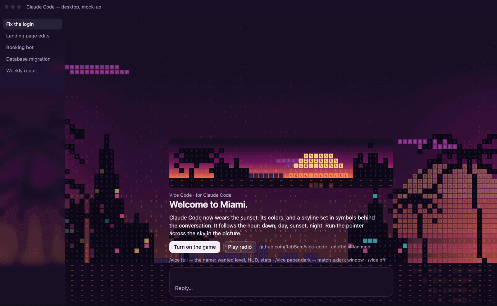
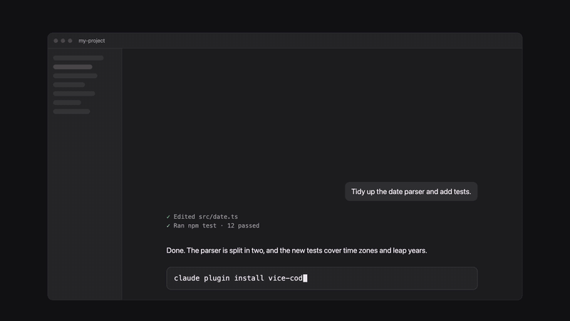
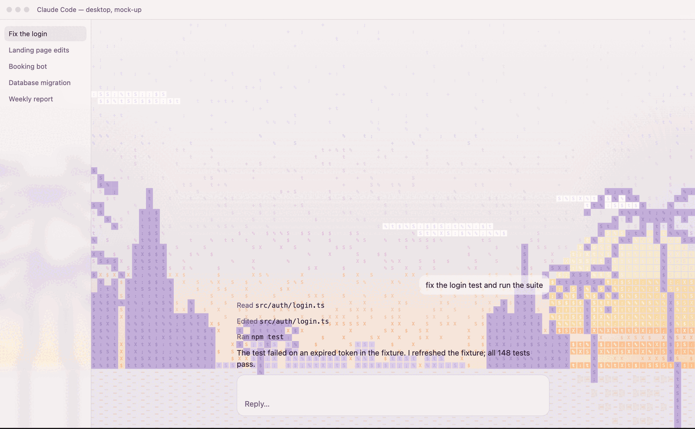
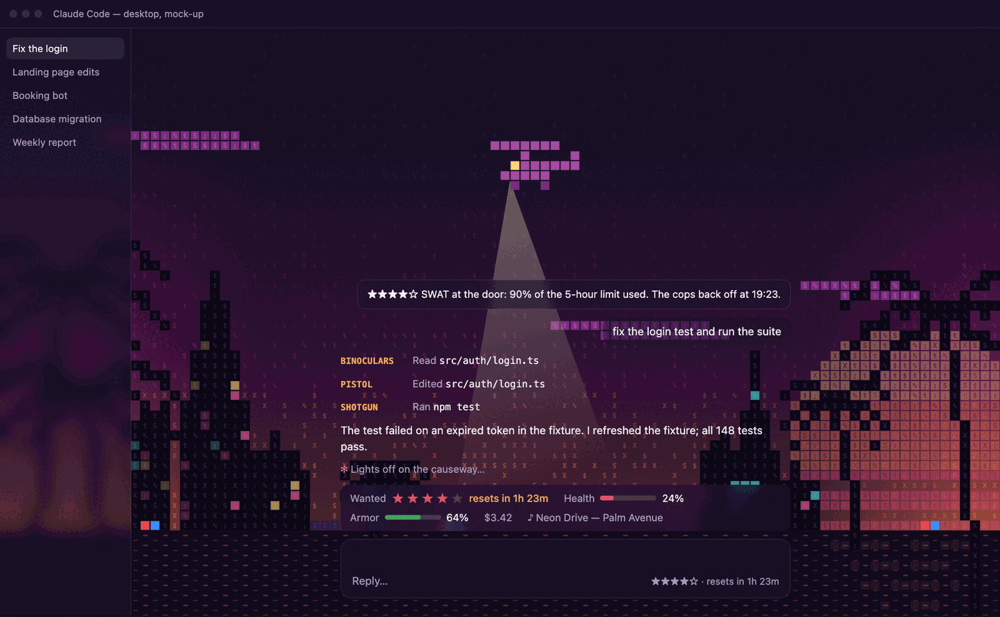
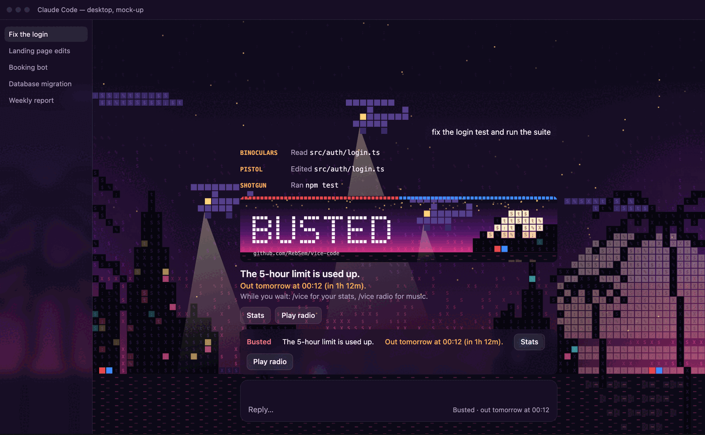
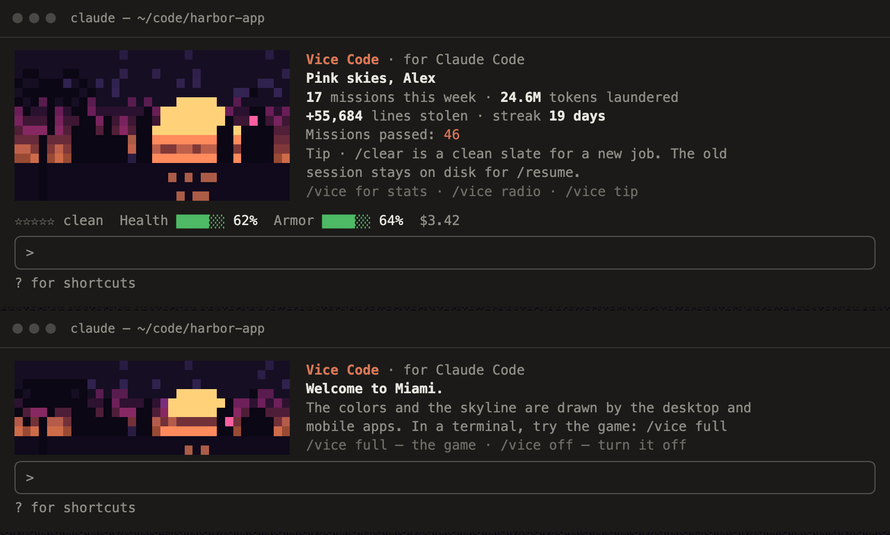

# Vice Code



A Miami sunset for Claude Code: the app's colors and a skyline set in symbols behind your conversation. One command adds a game where your usage limits are a wanted level.

Unofficial fan mod. Not affiliated with or endorsed by Anthropic or any game publisher.

> По-русски: [как потестить](docs/TESTING.md), [лимиты как розыск](docs/LIMITS.md), [дизайн](docs/DESIGN.md).



## Install

```bash
claude plugin install vice-code --marketplace RebSem/vice-code
```

Needs Claude Code 2.1.319 or newer (`claude update`). Open a new session. In the desktop app the window turns violet and a skyline stands behind the conversation, with one hello card that says what changed. In a terminal you get a small banner card at the top of each new conversation.

- Inside a session the same line works as a command: `/plugin install vice-code --marketplace RebSem/vice-code`, then `/reload-plugins`.
- In the desktop app: **+** next to the prompt box → **Plugins** → **Add marketplace** `RebSem/vice-code` → **Add plugin**.
- The installer says "17 userConfig options not yet set". That is not an error: every setting has a default.

Update with `claude plugin update vice-code@vice-code`, or turn on auto-update in `/plugin` → Marketplaces → vice-code. Remove with `claude plugin uninstall vice-code` and `claude plugin marketplace remove vice-code`. To try a local checkout for one session only: `claude --plugin-dir /path/to/vice-code`.

Don't see it?

1. Check the version: `claude --version` must say 2.1.319 or newer. On an older one the mod shows a single line asking you to update.
2. Open a new session. Desktop app: the window should turn violet with a skyline behind the conversation. Terminal: a banner card should stand at the top of the conversation.
3. If you turned the mod off with `/vice off`, it stays off until `/vice on`.
4. Run `claude --debug` and look for a line that starts with `vice-code:`. Add it to an issue.

## Two modes

**Lite** is the default: the look alone.



- The app's own colors: violet stock, pink accent, orange warnings, in a light and a dark version.
- A skyline set in symbols behind the conversation. It follows your local hour (dawn, day, sunset, night) and moves in slow steps: the sun's blind, palms, the tide, a boat, birds, clouds.
- One hello card after install, with a banner whose sky lights up under the pointer and a **Turn on the game** button.
- In a terminal or an editor, which draw neither the colors nor the skyline, Lite is a small banner card at the top of each new conversation.
- Lite reads nothing from your history and counts nothing: no HUD, no wanted level, no toasts.

**Full** is the game, on top of the same look.



- Your 5-hour limit is a wanted level, the weekly limit is armor, context is health.
- A HUD line above the prompt, gear labels on tool rows, Miami spinner lines, a stats pane from your local history.
- The skyline shows the heat: patrol lights at three stars, a car running the shore and a helicopter at four, two helicopters at five.
- When a limit runs out, a busted card says which one and when you are out.



Switch with `/vice full` (or the card's button) and `/vice lite`. The choice is stored and holds until you change the `mode` setting after it.

## The game

| | |
|---|---|
| **Wanted level** | The 5-hour limit as stars: ★ at 40%, ★★★ at 75% (the lights flash for a few seconds), ★★★★★ at 97%. A toast comes once per level from two stars up, with the time the cops back off. Get through a window after three stars and it counts as an escape. |
| **Busted** | When a limit runs out, or a request is turned away for one, a busted card stands in the conversation where Claude went quiet: which limit, and when you are out. It folds to one line when the window resets or Claude answers again. Nothing is blocked. With extra usage on, a window past 100% shows as "on credit" instead. |
| **HUD** | One quiet line above the prompt: wanted level with the reset time, health (context left before auto-compact), armor (what is left of the weekly limit) and cash (the session at API prices). `hud` in the settings makes it compact or turns it off. |
| **Welcome card** | Each new conversation opens with a card: your week in numbers, a tip about Claude Code and a countdown to 19 November 2026. Where the skyline already stands behind it, the card is words alone. |
| **Medkits** | A compaction is a medkit: the toast says how many tokens it freed. Health under 15% warns you once. |
| **Rap sheet and stats** | `/vice` opens a pane: missions, tokens laundered, lines stolen, busts, escapes, your arsenal (tools), rides (models) and turf (projects on a map), from your own history. |
| **Flavour** | Miami spinner lines ("Smuggling commits past CI"), chase lines from four stars up, gear labels on tool rows (SHOTGUN for Bash), street talk now and then, and a synthwave radio loop the mod synthesizes itself. |

The wanted level and armor need a Pro or Max plan: an API-key account has no usage windows, so there the game shows health, cash and stats.

## Where it shows

| | Terminal | Desktop app | VS Code | Mobile app |
|---|---|---|---|---|
| App colors | no | yes | no | yes |
| Skyline backdrop | no | yes | no | yes |
| Hello card (Lite) | each new conversation | once, after install | each new conversation | once, after install |
| Welcome card (Full) | yes | yes | yes | yes |
| Busted card (Full) | yes | yes | yes | yes |
| HUD line and wanted level next to the prompt (Full) | yes | yes | no | no |
| `/vice` pane (Full) | yes | yes | yes | no |
| Sound (radio, siren, medkit chime) | macOS | yes | no | no |

The table follows what each surface draws according to the mods API. In a terminal you can see the skyline as a pixel banner on the cards.



## Commands

All through one command, `/vice`.

| Command | What it does |
|---|---|
| `/vice full` | Turn the game on |
| `/vice lite` | Turn the game off, keep the look |
| `/vice off` | Turn the whole mod off, in this session and the next ones: the look is cleared and every hook steps aside |
| `/vice on` | Bring it back |
| `/vice paper dark`, `light`, `auto` | Pick the stock the scene prints on; `dark` and `light` also send the colors for that one mode |
| `/vice backdrop` | Skyline on or off |
| `/vice card` | Show the card again |
| `/vice radio` | Radio on or off |
| `/vice` | In Full: open the stats pane. In Lite: list the commands |
| `/vice wanted` | Full: open the rap sheet (wanted level, armor, busts, medkits) |
| `/vice tip` | Full: next tip |
| `/vice import` | Full: read new sessions (`/vice import full` re-reads every transcript) |

A choice made with `/vice` (mode, paper, backdrop) is stored and holds until the setting of the same name is changed after it. Then the setting wins.

## Settings

Everything is in `/config` under vice-code, and everything has a default.

| Setting | Default | What it does |
|---|---|---|
| `mode` | `lite` | `lite` is the look alone, `full` adds the game |
| `colors` | on | Paint the desktop and mobile apps in the look's colors |
| `backdrop` | on | The skyline behind the conversation |
| `paper` | `auto` | The scene's stock: `auto` follows the window, or `light`, `dark` |
| `language` | `auto` | `auto`, `ru` or `en`; auto follows the language you write prompts in |
| `playerName` | empty | Name on the welcome card; empty uses your account name |
| `wanted` | on | Game: usage limits as a wanted system |
| `hud` | `full` | Game: `full`, `compact` (wanted level only) or `off` (a bust still shows) |
| `weapons` | on | Game: gear labels on tool rows |
| `spinner` | on | Game: Miami spinner lines |
| `toasts` | on | Game: street talk after a turn now and then |
| `toastEvery` | 12 | Turns between two street-talk lines, never more often than every 20 minutes |
| `showCost` | on | Session cost in the HUD |
| `importHistory` | on | Game: count past sessions from your local transcripts |
| `sounds` | off | A siren at four stars and when busted, a chime for a medkit |
| `radioVolume` | 0.6 | 0 is silent, 1 is normal, up to 2 boosts (macOS) |
| `radioUrl` | empty | A Spotify, Apple Music or YouTube link for the "Your radio" button |

## Privacy

The mod makes no network requests: no telemetry, no model calls. Sounds are synthesized on your machine. Under `claude -p` or an SDK script it does nothing at all.

**Lite** reads no history. It asks the machine for its time zone (`date +%z`) and the language from your environment, and stores only your choices (mode, paper, backdrop, off), the language it last saw you write in, and whether the hello card was shown.

**Full** reads your local Claude Code transcripts in `~/.claude/projects` (or `$CLAUDE_CONFIG_DIR/projects`), including subagent transcripts, on your machine only, to count stats. It runs three local programs, never a shell: `awk` to summarize transcripts, `date +%z` for your time zone, and `id -F` once for your first name on macOS. In the plugin's own local store (`$.store`, at most 4 MiB) it keeps:

- per transcript: its folder and file name, size and modification time, the project folder name, first and last timestamps, active time, how many prompts you typed and how many of them were in Cyrillic (for the auto language), token and response counts, tool and model names with their counts, cost and lines added and removed, rate-limit windows hit, compactions with the tokens they freed, and API outages;
- your player name, your escape and most-wanted records, and the wanted system's memory (which levels were announced in the current windows, the current bust).

Prompt text, answers and code are never stored. Sound plays only when you ask for it: the radio on `/vice radio`, and a siren and a medkit chime when `sounds` is on.

## Known limits

- The look (colors and skyline) is drawn only by the desktop and mobile apps. The terminal and VS Code keep their own colors.
- Nothing here has been watched in a live window by the mod's tests. The test kit checks the tree of elements, not pixels.
- In the desktop and mobile apps the mod wakes when the app's window attaches to the session. That follows the mods API's description of app sessions; if the look never appears there, please open an issue with the `vice-code:` lines from `claude --debug`.
- Whether the pointer reaches the skyline behind the conversation depends on the app. The hello card's banner is a row in the conversation and does take hover.
- The scene picks light or dark paper by `prefers-color-scheme` inside its own frame. If it ever disagrees with your window, `/vice paper dark` or `/vice paper light` fixes it.
- A session has one theme: Vice Code replaces another mod's look, and the other mod replaces Vice Code's.
- The engine sends no event when a usage window resets, so the busted card folds a few seconds after the reset, on the mod's own alarm.
- A limit the numbers do not show (a single model's weekly cap) is seen only when a request is turned away; its release time is unknown, and the card says so.

## How it is made

A Claude Code mod made of function hooks (`hooks/register.tsx`). Every picture is built from one grid: the sky is a field of glyphs that brightens toward the horizon, while the city, the palms and the slatted sun are square tiles, so the silhouette stays clear (`hooks/lib/tiles.ts`). The same code draws the backdrop, the card banners, the busted banner, the icon and the terminal's pixels. The colors come from `makeColors` (`hooks/make-colors.js`) with a few anchors in `hooks/lib/look.ts`, and go out with the scene in one `$.theme.set`.

Motion is stepped: every animation uses `steps()`, so the scene repaints a few times a second at most, and it rests in a composed picture when your system asks for reduced motion. In narrow windows and on phones the two sides of the scene step toward the middle. Words and numbers are the app's own text, in its fonts and theme colors.

The mod draws everything from code. It ships no audio files, and the only images in the repository are the icon and this page's pictures: the radio and the effects are synthesized on first use. The tile technique follows Anthropic's `theme-examples` plugin, which is published to be read, copied and changed. Real Miami places are used as flavour. No game assets, logos, characters or music are included. `hooks/make-colors.js` and its `.d.ts` are Anthropic's theme helper, copied unchanged from Claude Code's plugin-authoring kit, as its guide tells a mod to do. The design notes are in [docs/DESIGN.md](docs/DESIGN.md) (in Russian).

## Development

The tests (59) run in Claude Code's test kit; they pass on 2.1.319 (terminal CLI) and 2.1.325 (the desktop app's engine).

```bash
claude plugin test .
```

```bash
claude plugin validate --strict .
```

Release check, so no names of the game or its studio ship (empty output means clean):

```bash
sh tools/ip-check.sh
```

The pictures on this page are mock-ups, not screenshots of the app: `tools/preview.ts` builds them from the mod's own scenes, words and view models, and lays out a stand-in window around them. To build the full page of mock-ups, see step 0 in [docs/TESTING.md](docs/TESTING.md).

## License

MIT License. Art direction, code and the "Neon Drive" loop are original work for this project.

Unofficial fan mod. Not affiliated with or endorsed by Anthropic or any game publisher.
